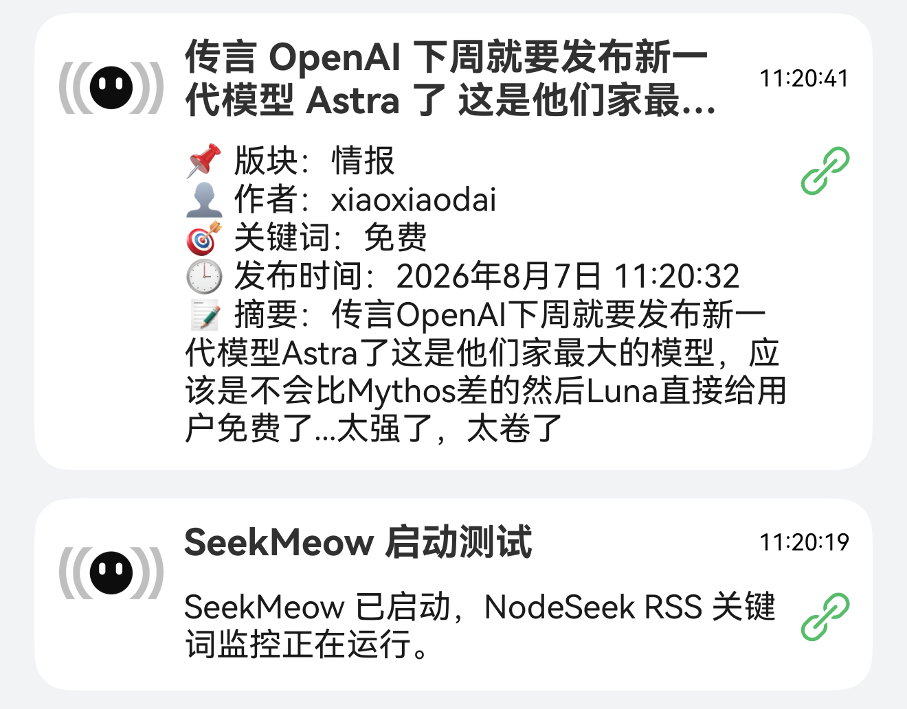

<div align="center">
  <h1>SeedMeow</h1>
  <p>自动监控论坛新帖，筛选后推送到 MeoW</p>
</div>

<p align="center">
  
</p>

<p align="center">
  <a href="https://github.com/sunnyhmz7010/SeedMeow/releases"></a>
  <a href="https://github.com/sunnyhmz7010/SeedMeow/blob/main/LICENSE"></a>
</p>

---

## ✨ 为什么做这个项目

NodeSeek 和烧饼论坛上的优惠、补货与交易帖子更新很快，反复刷新容易错过。SeedMeow 订阅两站的官方订阅源，按你的关注规则筛选新帖，再通过 MeoW 发送通知。

- 关注特定地区、线路或品牌的 VPS 优惠与补货。
- 按版块或关键词订阅交易、域名、硬件等信息。

## 📸 截图预览



## 🚀 核心能力

- 双源监控：直连 NodeSeek RSS 与烧饼论坛 Atom，可同时监控两站，也可只启用一个来源。
- 独立配置：每站分别设置 MeoW 昵称、筛选规则和轮询间隔，订阅源请求失败互不阻塞。
- 规则筛选：支持关键词、组合词、正则和版块匹配，可按标题或摘要筛选，并设置版块过滤与屏蔽词。
- MeoW 推送：通知包含来源名称、图标、中文版块和帖子链接，两站可使用同一个昵称。
- 去重补推：按来源保存已处理记录和待重试帖子，重启后继续去重与补推。
- 运行自检：支持启动通知、定期自检、订阅源异常与恢复提醒，以及版本更新提示。

## ⚡ 快速开始

### 📋 前置要求

- Docker：支持 Linux amd64 或 arm64 容器的 Docker Engine；使用 Compose 部署还需 Docker Compose。
- MeoW：准备可接收通知的 MeoW 昵称；两个来源可以共用昵称。
- 网络：能够访问 `ghcr.io`、`https://rss.nodeseek.com/`、`https://sb.sb/atom.xml` 和 `https://api.chuckfang.com`。

### 📦 安装与运行

#### 🐳 Docker 部署

```bash
docker run -d \
  --name seedmeow \
  --restart unless-stopped \
  --stop-timeout 60 \
  -e SOURCES="nodeseek,sb" \
  -e NODESEEK_MEOW_NICKNAME="你的MeoW昵称" \
  -e NODESEEK_KEYWORDS="VPS,补货" \
  -e SB_MEOW_NICKNAME="你的MeoW昵称" \
  -e SB_KEYWORDS="VPS,优惠" \
  -v seedmeow-data:/app/data \
  ghcr.io/sunnyhmz7010/seedmeow:latest
```

也可以使用 Docker Compose：根目录已提供 `compose.yaml`，执行以下命令即可启动：

```bash
docker compose up -d
```

启动时会尝试发送各来源的自检通知。日志出现“监控已启动”和“首次扫描建立基线”后，会开始处理后续新帖。

## 📖 使用说明

### 📋 来源与配置

全局变量 `SOURCES` 默认是 `nodeseek,sb`。设置为 `nodeseek` 或 `sb` 可只启用一个来源；停用来源的配置不会校验。

其余变量使用对应前缀：NodeSeek 为 `NODESEEK_`，烧饼为 `SB_`。例如 `NODESEEK_KEYWORDS=VPS`、`SB_KEYWORDS=补货`。请在 Docker Run 的 `-e` 参数或 `compose.yaml` 的 `environment` 中设置配置。

下表列出变量后缀，使用时加上对应前缀。

| 后缀 | 默认值 | 说明 |
| --- | --- | --- |
| `MEOW_NICKNAME` | 必填 | MeoW 昵称，不能包含 `/` |
| `CHECK_INTERVAL_SECONDS` | NodeSeek `5`；烧饼 `60` | 轮询秒数，整数 1–2147483 |
| `KEYWORDS` | 空 | 英文逗号分隔，命中任一关键词即可 |
| `KEYWORD_GROUPS` | `[]` | JSON 二维数组，组内全部命中、组间任一命中 |
| `REGEX_PATTERNS` | `[]` | JSON 字符串数组，使用 `iu` 标志，任一正则命中即可 |
| `PUSH_CATEGORY` | 空 | `all` 或逗号分隔的版块标识，命中版块即可构成正向规则 |
| `CATEGORIES` | `all` | 对所有正向规则生效的版块过滤，多个标识用英文逗号分隔 |
| `BLOCK_KEYWORDS` | 空 | 英文逗号分隔，命中任一屏蔽词即拒绝推送 |
| `MATCH_SCOPE` | `all` | `title`、`summary` 或 `all`，同样决定屏蔽词的匹配范围 |
| `PUSH_EXISTING` | `false` | 首次成功扫描是否推送已有命中帖 |
| `SHOW_LINK_URL` | `false` | 是否在正文底部额外附上可复制的链接 |
| `HEALTH_CHECK_MINUTES` | `1440` | 自检分钟数，整数 0–1440；0 关闭定期自检 |

每个启用的来源至少配置 `KEYWORDS`、`KEYWORD_GROUPS`、`REGEX_PATTERNS`、`PUSH_CATEGORY` 中的一项。四类正向规则是“或”关系；版块过滤和屏蔽词可以否决所有命中结果。

组合词示例：将 `NODESEEK_KEYWORD_GROUPS` 设为 `[["香港","VPS"],["日本","线路"]]`。正则示例：将 `SB_REGEX_PATTERNS` 设为 `["年付\\s*\\d+"]`。JSON 配置需要作为字符串传入，并保留其中的引号与转义。

### 🗂️ 版块标识

| 来源 | 可用标识 |
| --- | --- |
| NodeSeek | `daily` 日常、`tech` 技术、`info` 情报、`review` 测评、`trade` 交易、`carpool` 拼车、`promo` 推广、`life` 生活、`dev` Dev、`photo-share` 贴图、`expose` 曝光、`inner` 内版、`sandbox` 沙盒 |
| 烧饼 | `general` 综合、`ai` AI、`domains` 域名、`hosting` 主机、`hardware` 硬件、`trade` 交易、`promotion` 推广、`discounts` 优惠、`share` 分享、`tech` 技术、`jobs` 工作、`invest` 投资、`announcement` 公告 |

版块标识按来源分别校验。修改配置后，使用原部署方式重新创建容器以应用新值。

## 🧠 功能细节

- 首次扫描：默认将各来源当时已有帖子记为基线，不推送历史帖子；可单独设置对应来源的 `PUSH_EXISTING=true`。
- 状态保存：两站分别使用 `/app/data/nodeseek/state.json` 和 `/app/data/sb/state.json`，各保留最多 1000 个已处理 ID 和 1000 条待重试消息。
- 失败补推：帖子推送失败后进入该来源的待重试队列，在后续成功轮询时补推；MeoW 明确返回敏感词 403 时会丢弃该帖并标记已处理。
- 故障处理：订阅源连续两次异常会尝试通知，恢复后尝试发送恢复通知；配置或状态文件错误会明确报错并退出。
- 自检行为：启动和定期自检通知失败会记录日志并继续监控，自检通知不进入帖子补推队列，同一来源的定期自检不会重叠。
- 停止与存储：收到 `SIGTERM` 或 `SIGINT` 后等待当前任务结束再退出，容器预留 60 秒停止时间；删除容器会保留命名卷，删除卷会清空去重和补推记录。

## 🧱 技术栈

- JavaScript：使用 ESM 编写监控、匹配与推送逻辑。
- Node.js 24+：提供原生 `fetch`、任务调度和 `node --test` 测试运行器。
- `@xmldom/xmldom` 0.9.10：解析 RSS、Atom 和 HTML 摘要。
- Docker：基于 `node:24-alpine` 构建镜像，以非 root 用户运行，并通过 Compose 部署。

## 🗂️ 项目结构

```text
SeedMeow/
├── src/
│   ├── sources/       # 两站解析器与来源信息
│   ├── index.js       # 启动编排、信号处理与自检
│   ├── config.js      # 按来源解析和校验配置
│   ├── matcher.js     # 帖子匹配规则
│   ├── meow.js        # 消息格式与推送
│   ├── monitor.js     # 轮询、去重与补推
│   └── state.js       # 状态持久化
├── test/              # 离线回归测试
├── screenshot-notification.png  # MeoW 通知示例
├── compose.yaml       # 镜像部署与运行配置
├── Dockerfile
└── package.json
```

## 👨‍💻 本地开发

### 🧰 环境

- 开发平台：Windows、Linux 或 macOS。
- Node.js：24 或更高版本，包含 npm。

### 🧪 安装与测试

```bash
npm ci
npm test
```

### ▶️ 本地运行

以下命令使用 Bash，仅启用 NodeSeek；将昵称替换为实际值。

```bash
SOURCES=nodeseek \
NODESEEK_MEOW_NICKNAME="你的MeoW昵称" \
NODESEEK_KEYWORDS="VPS,补货" \
npm start
```

状态保存在当前工作目录的 `data/` 中。

## 🔐 安全报告

如果发现安全问题，请不要公开披露细节。请优先参考仓库中的 [SECURITY.md](./SECURITY.md) 提交安全报告。

## 📄 许可证

本项目基于 [GPL-3.0](./LICENSE) 开源。

<div align="center">
  <sub>Built with ❤️ by Sunny</sub>
</div>
